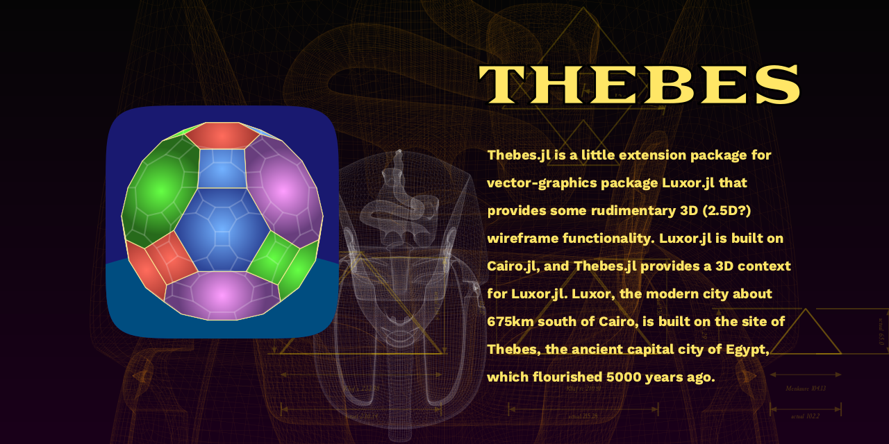

| **Documentation**                                  | **Build Status**                          | **Tests and Coverage**          |
|:--------------------------------------------------:|:-----------------------------------------:|:-------------------------------:|
| [![][docs-stable-img]][docs-stable-url]            | [![Build Status][ci-img]][ci-url]         | [![][codecov-img]][codecov-url] |
| [![][docs-development-img]][docs-development-url]  | [![PkgEval][pkgeval-img]][pkgeval-url]    |  |

# Thebes

Thebes.jl is a little extension package for vector-graphics package [Luxor.jl](https://github.com/JuliaGraphics/Luxor.jl) that provides some rudimentary 3D (2.5D?) wireframe functionality.

#### ‘Thebes’?

Luxor.jl is built on [Cairo.jl](https://github.com/JuliaGraphics/Cairo.jl), and Thebes.jl provides a 3D context for Luxor.jl. Luxor, the modern city about 675km south of Cairo, is built on the site of Thebes, the ancient capital city of Egypt, which flourished 5000 years ago.

# Acknowledgements

Many thanks to @c42f who helped me implement the rotations using Rotations.jl!

[docs-development-img]: https://img.shields.io/badge/docs-development-blue.svg
[docs-development-url]: http://cormullion.github.io/Thebes.jl/dev/

[docs-stable-img]: https://img.shields.io/badge/docs-stable-blue.svg
[docs-stable-url]: http://cormullion.github.io/Thebes.jl/dev/

[codecov-img]: https://codecov.io/gh/cormullion/Thebes.jl/branch/master/graph/badge.svg
[codecov-url]: https://codecov.io/gh/cormullion/Thebes.jl

[ci-img]: https://github.com/cormullion/Thebes.jl/workflows/CI/badge.svg
[ci-url]: https://github.com/cormullion/Thebes.jl/actions?query=workflow%3ACI

[pkgeval-img]: https://juliaci.github.io/NanosoldierReports/pkgeval_badges/T/Thebes.svg
[pkgeval-url]: https://juliaci.github.io/NanosoldierReports/pkgeval_badges/T/Thebes.html
